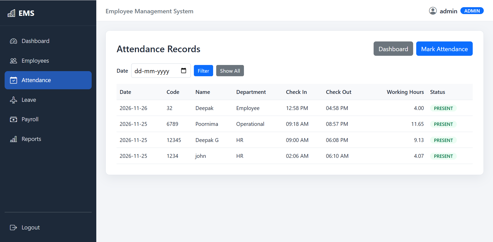
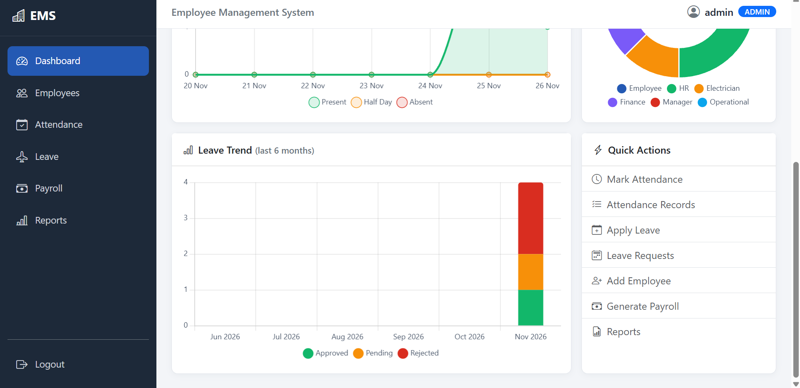
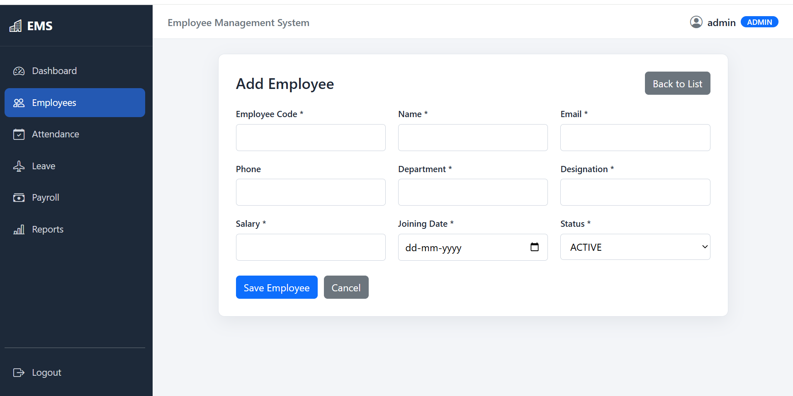
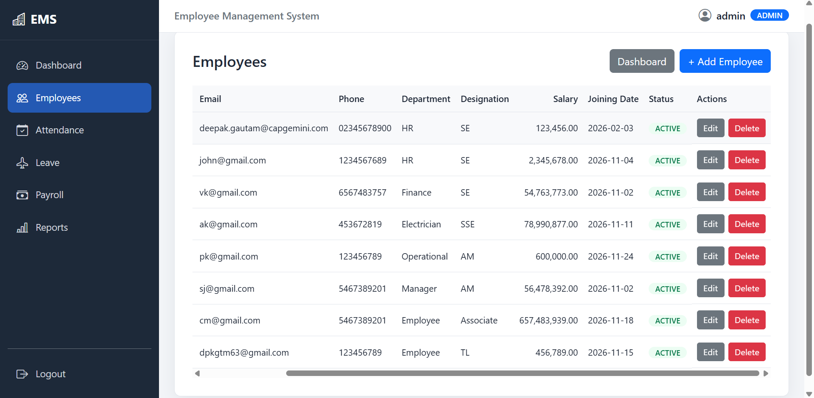
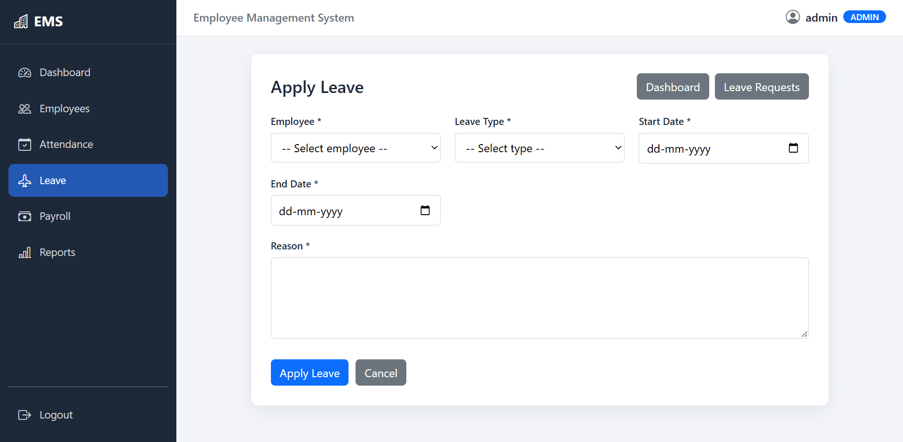
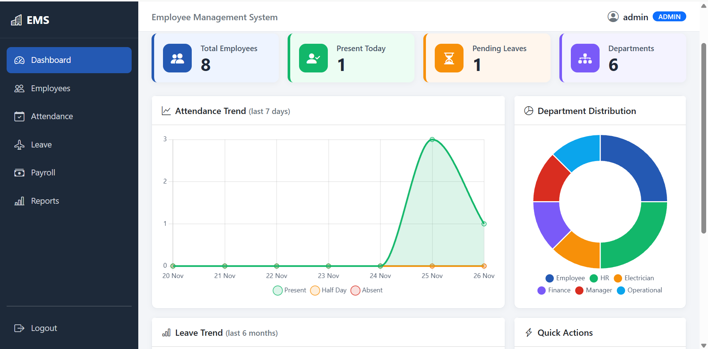
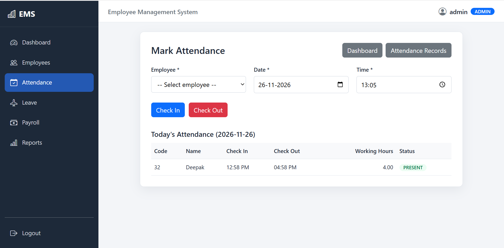
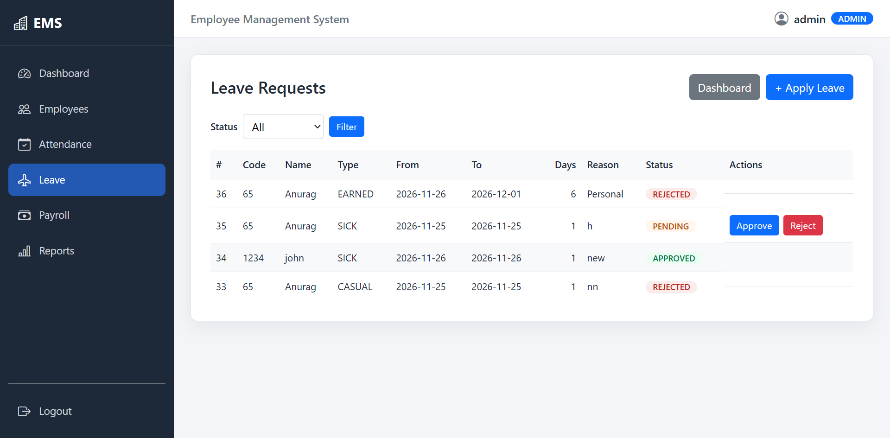
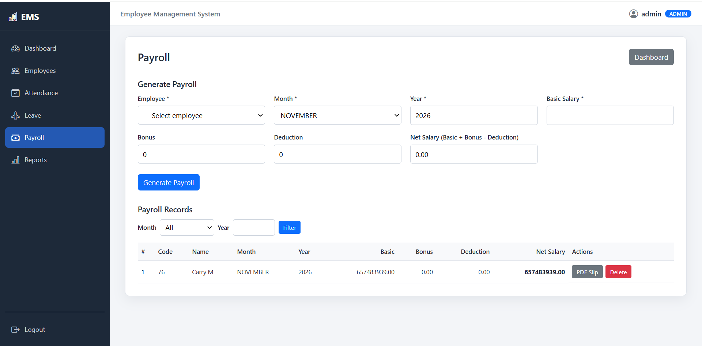

# Employee Management System (EMS)

A role-based web application for managing employees, attendance, leave, payroll, and email notifications.
It's built with **Spring Boot 4, Spring Security, Spring Data JPA, JSP/JSTL, and Bootstrap 5**.

---

## Tech Stack

| Layer        | Technology                                                       |
|--------------|------------------------------------------------------------------|
| Language     | Java 17                                                          |
| Framework    | Spring Boot 4.2 (Web MVC, Data JPA, Validation, Security, Mail)  |
| View         | JSP + JSTL, Spring Security taglibs                              |
| UI           | Bootstrap 5.3, Bootstrap Icons, Chart.js (served via WebJars)    |
| Database     | H2 (file-based, MySQL mode) and H2 Console                       |
| PDF          | iText 5 (salary slips)                                           |
| Email        | Spring Boot Starter Mail (JavaMailSender / SMTP)                 |
| Build        | Maven (WAR packaging, embedded Tomcat)                           |
| Utilities    | Lombok, Spring DevTools                                          |

---

## Features Completed

### 1. Authentication & Role-Based Access (Spring Security)
- Custom login page (`/login`). You can sign in with your **username or email**.
- Passwords are stored as **BCrypt** hashes.
- Three roles: `ADMIN`, `MANAGER`, `EMPLOYEE`.
- Demo users are seeded automatically on startup (see [Default Logins](#default-logins)).
- URL access rules:
  | URL                                              | Access                 |
  |--------------------------------------------------|------------------------|
  | `/employee/**`, `/payroll/**`, `/report/**`, `/download/**` | ADMIN only  |
  | `/leave/approve/**`, `/leave/reject/**`          | ADMIN, MANAGER         |
  | Everything else (dashboard, attendance, leave apply/list) | Any logged-in user |
- If a user without the required role opens a page, they see a custom **Access Denied (403)** page.
- Logout (`POST /logout`) and CSRF protection are enabled.

### 2. Dashboard
- Summary cards: total employees, departments, employees present today, and pending leaves.
- Interactive **Chart.js** charts loaded from `/dashboard/chart-data` (JSON):
  - Attendance trend (Present / Half Day / Absent)
  - Leave trend (Approved / Pending / Rejected)
  - Department-wise employee distribution

### 3. Employee Management (ADMIN)
- Add, edit, list, and delete employees.
- Fields: employee code, name, email, phone, department, designation, salary, joining date, and status (`ACTIVE` / `INACTIVE`).
- Server-side validation using Bean Validation, plus unique checks for employee code and email.

### 4. Attendance Management
- **Check-in / Check-out** for an employee on a given day.
- Working hours are calculated automatically. Less than **4 hours** counts as `HALF_DAY`; otherwise the status is `PRESENT`.
- Prevents duplicate check-ins and a check-out without a check-in.
- Attendance list with a date filter.

### 5. Leave Management
- Apply for leave. Leave types: `CASUAL`, `SICK`, `EARNED`, `UNPAID`.
- Validation: the end date can't be before the start date, and overlapping pending or approved leaves are blocked.
- ADMIN or MANAGER can **approve** or **reject** a `PENDING` leave.
- Leave list with a status filter (`PENDING` / `APPROVED` / `REJECTED`).

### 6. Payroll Management (ADMIN)
- Generate a monthly payroll per employee.
- **Net Salary = Basic + Bonus − Deduction**. A negative net salary is rejected.
- Only one payroll per employee per month/year.
- Filter by month and year, and delete payroll records.
- **Download the salary slip as a PDF** (`/download/salarySlip/{employeeId}`), generated with iText.

### 7. Email Notifications ✉️
The system automatically sends email notifications for the main HR events:

| Event                       | Recipient(s)                          |
|-----------------------------|---------------------------------------|
| Leave applied               | The employee (confirmation)           |
| Leave applied               | All ADMIN and MANAGER users (approval request) |
| Leave approved / rejected   | The employee                          |
| Payroll generated           | The employee (salary breakdown)       |

How it works:
- `EmailUtil` builds the subject and body for each notification. `EmailService` sends it through `JavaMailSender`.
- Emails are sent **only after the database transaction commits**, so a failed or rolled-back operation never sends an email.
- If sending fails (for example, the SMTP server is down), the failure is **logged** and the business operation still succeeds.
- **Safe by default:** with `ems.mail.enabled=false`, emails are written to the application log (`[EMAIL disabled] ...`) instead of being sent.

### 8. Reports (ADMIN)
- Reports page (`/report`), restricted to ADMIN.

### 9. Automated Tests
70 passing tests (MockMvc + Spring Security Test + in-memory H2) cover:
- Role-based access for every module (`RoleAccessTests`)
- Employee, Attendance, Leave, Payroll, and Dashboard controllers

---

## Screenshots

### Dashboard




### Employees




### Attendance




### Leave




### Payroll


---

## Project Structure

```
src/main/java/com/ems
├── config/        AppConfig (BCrypt, demo users), SecurityConfig
├── controller/    Login, Dashboard, Employee, Attendance, Leave, Payroll, Report, Download, AccessDenied
├── dto/           LeaveDTO, PayrollDTO, DashboardChartsDTO, ...
├── entity/        User, Role, Employee, Attendance, LeaveRequest, Payroll + status enums
├── repository/    Spring Data JPA repositories
├── service/       Business logic + EmailService, PdfService, DashboardService, CustomUserDetailsService
└── util/          EmailUtil (email templates), PdfGenerator (salary slip)
src/main/webapp/WEB-INF/views   JSP pages (common header/navbar/sidebar/footer + module pages)
src/main/resources/static       CSS, JS, images
```

---

## Getting Started

### Prerequisites
- JDK 17 or later
- You don't need to install Maven separately. The Maven wrapper (`mvnw` / `mvnw.cmd`) is included.

### Run
```bash
# Windows
mvnw.cmd spring-boot:run
# Linux / macOS
./mvnw spring-boot:run
```
Open **http://localhost:8080**.

### Run Tests
```bash
mvnw.cmd test
```

### H2 Database Console
- URL: http://localhost:8080/h2-console
- JDBC URL: `jdbc:h2:file:./data/ems_db`
- User: `sa` (no password)

---

## Default Logins

| Role     | Username   | Email              | Password      |
|----------|------------|--------------------|---------------|
| ADMIN    | `admin`    | admin@ems.com      | `admin123`    |
| MANAGER  | `manager`  | manager@ems.com    | `manager123`  |
| EMPLOYEE | `employee` | employee@ems.com   | `employee123` |

---

## Email Configuration

By default, emails are only logged. To send real emails, set these environment variables before you start the app. Don't commit credentials to the repository.

| Variable           | Description                          | Default            |
|--------------------|--------------------------------------|--------------------|
| `EMS_MAIL_ENABLED` | `true` to actually send emails       | `false`            |
| `EMS_MAIL_FROM`    | Sender address                       | `no-reply@ems.com` |
| `MAIL_HOST`        | SMTP host                            | `smtp.gmail.com`   |
| `MAIL_PORT`        | SMTP port                            | `587`              |
| `MAIL_USERNAME`    | SMTP username                        | *(empty)*          |
| `MAIL_PASSWORD`    | SMTP password / Gmail App Password   | *(empty)*          |

Example (PowerShell, Gmail):
```powershell
$env:EMS_MAIL_ENABLED="true"
$env:MAIL_USERNAME="your-account@gmail.com"
$env:MAIL_PASSWORD="your-16-char-app-password"
$env:EMS_MAIL_FROM="your-account@gmail.com"
.\mvnw.cmd spring-boot:run
```
> For Gmail, turn on 2-Step Verification and create an **App Password**. Your normal Gmail password won't work.
